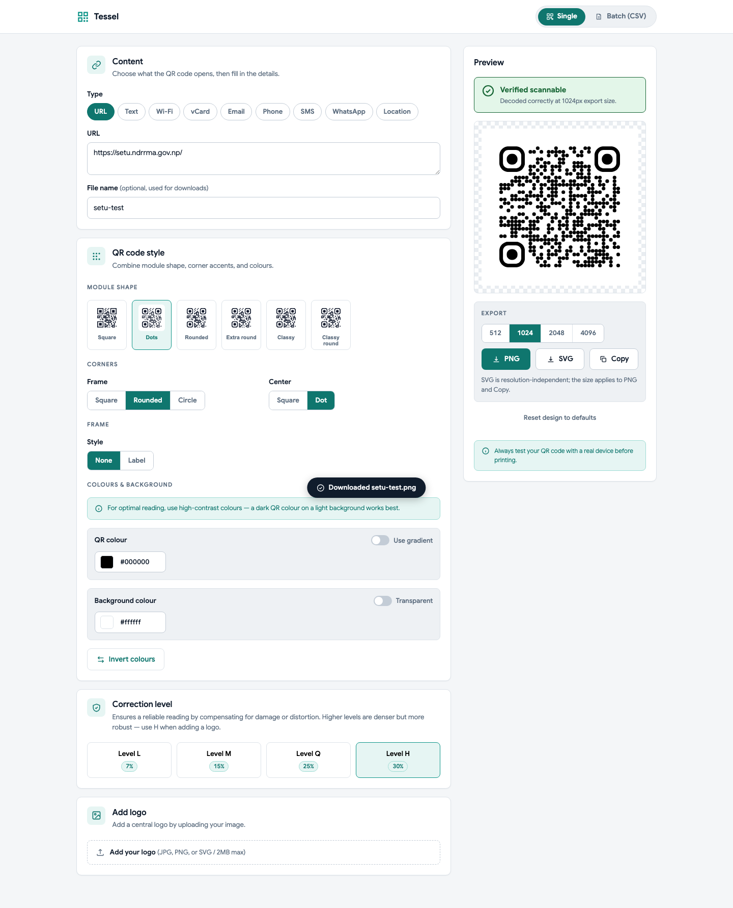

# Tessel

A QR code generator with single and batch (CSV) generation, styled QR designs, and SVG/PNG export.



## Features

- **Single QR codes** — nine content types (URL, text, Wi-Fi, vCard, email, phone, SMS, WhatsApp, location), all static payload formats with no backend; style the code and download as SVG or PNG.
- **CTA frames** — wrap the code in a labelled frame ("SCAN ME", editable) that follows the QR colour; the label band sits outside the ISO quiet zone and the framed artifact is what gets verified.
- **Batch from CSV** — upload a CSV (`qrName,hostname,scanLimit,url`), preview the rows, and download every QR code in one ZIP (PNG, SVG, or both). A template CSV is downloadable in-app.
- **Design settings** — module shapes (square, dots, rounded, classy…), solid or gradient colours, transparent background, invert, corner frame/center styles, error correction level (L/M/Q/H), central logo upload with size control, and export resolution up to 4096px.
- **Live scannability check** — every preview is decoded with ZXing in the browser; a badge tells you whether the current design actually scans before you print it. Batch runs verify every generated code the same way, marking each row verified or failed — and a later design change resets those claims rather than letting them go stale.
- **Guideline enforcement** — quiet zone of ≥4 modules per ISO/IEC 18004 (computed from the symbol version, in both the app and the CLI), a caution on inverted light-on-dark codes and transparent backgrounds, a density warning for long content, and a logo cap at 40% so ECC H can still recover the obscured modules.

## Run the app

It's a static site — no build step. Serve the folder and open it:

```bash
bunx serve .
# or
python3 -m http.server 8000
```

Then open http://localhost:8000 (or the URL `serve` prints). Opening `index.html` directly from the file system mostly works too, but the scannability badge needs an HTTP origin.

## CLI batch generation

Generate QR codes from a CSV without the browser:

```bash
bun install
bun scripts/generate-batch.mjs path/to/file.csv out-dir
bun run verify                # decodes every PNG in output/ to prove it scans
```

`bun run batch` with no arguments expects `SampleFiles/batch_links.csv` and writes to `output/` — both directories are local-only (gitignored), so create your own CSV or pass explicit paths.

## Tests

```bash
bun run test   # headless-browser smoke test: single flow, batch flow, downloads, responsive check
```

Requires Playwright's Chromium (`bunx playwright install chromium`). The batch part of the test also needs a local `SampleFiles/batch_links.csv`.

## CSV format

```csv
qrName,hostname,scanLimit,url
My First QR,,,https://example.com
```

- `qrName` → output file name
- `url` → QR content (scheme-less URLs are normalized to `https://`)
- `hostname` and `scanLimit` are accepted but ignored — scan limits and custom hostnames require a dynamic-QR redirect service, which a static generator cannot provide.

## A note on dot-styled finder corners

The original sample QR rendered the three finder corners as chains of dots. ZXing (the decoder inside most scanner apps) cannot reliably detect those, so this project renders data modules as dots but keeps the finder corners solid — same look, reliably scannable. This is verified automatically by `npm run verify` and the in-app badge.
